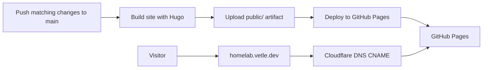

The documentation site is built with Hugo and published to [GitHub Pages](https://pages.github.com/). The source content lives in `docs/`, but the generated site is not committed to the repository.

The [documentation workflow](https://github.com/vetlekise/homelab/blob/main/.github/workflows/documentation.yaml) runs when changes are pushed to `main`, and only on specific directory/file paths (see workflow file).

The workflow installs Go and Hugo, builds the site with Hugo's garbage collection and minification enabled, uploads the generated `public/` directory as a Pages artifact, and deploys that artifact to GitHub Pages.

The site uses the custom domain <https://homelab.vetle.dev/>. The domain's DNS is hosted by Cloudflare, where a CNAME record points the site hostname to GitHub Pages.

To preview the site or check a build locally, see [Preview the documentation site](../guides/preview-documentation.md).

For the decision behind this setup, see [ADR 0010](architecture/adr/0010-github-pages.md).
